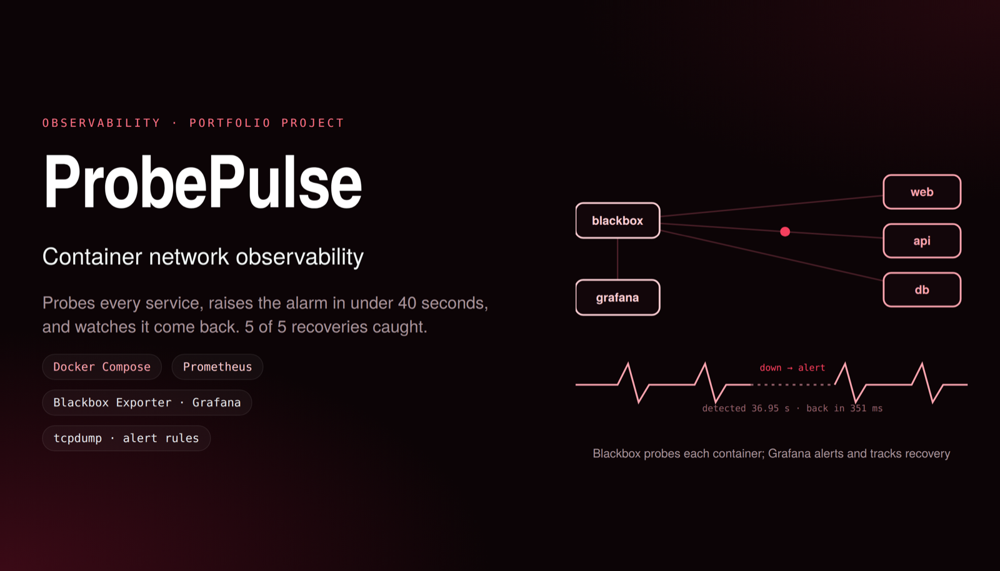
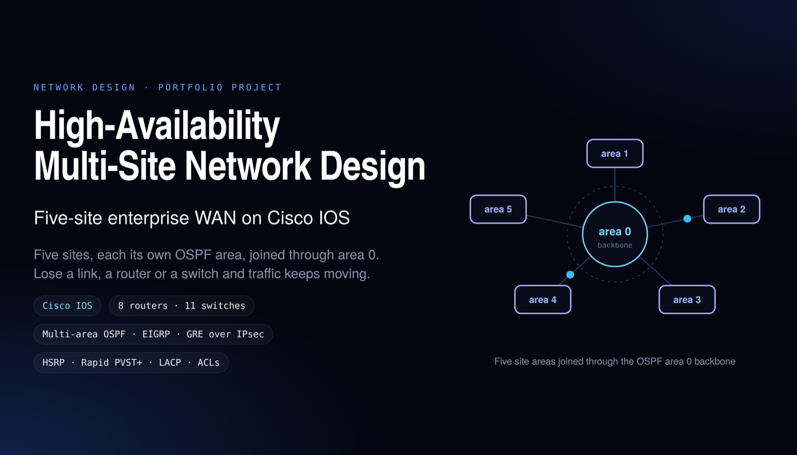
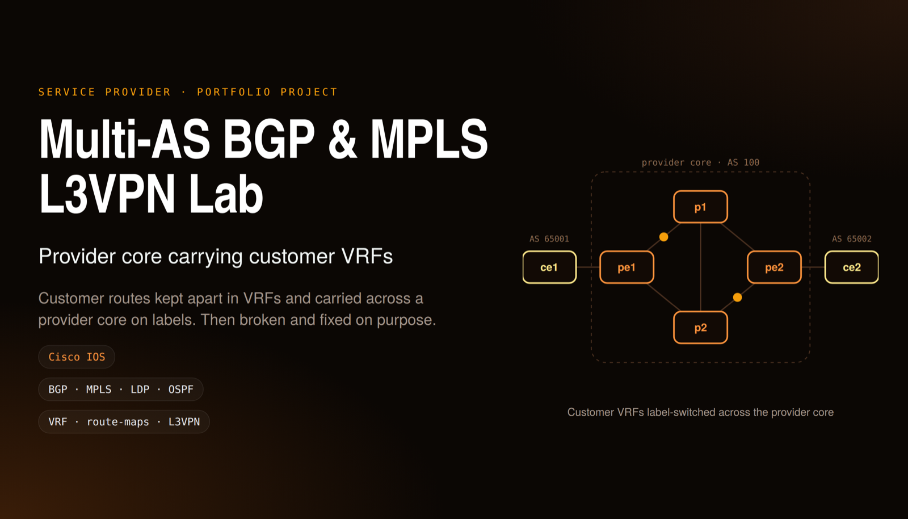
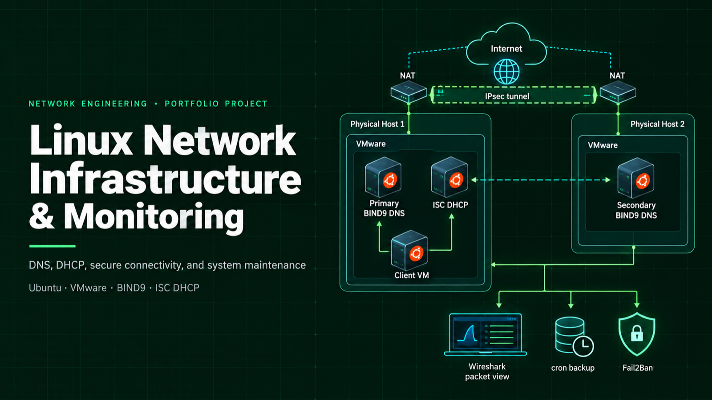
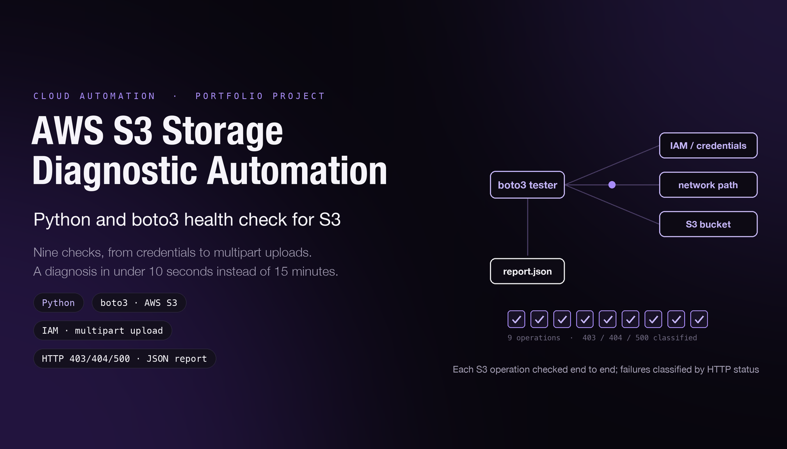

# 👋 Hi, I'm Jeevanandh Ravi

**Network Engineer · Network Automation · AI-Network Engineering · Cisco & Juniper**
MS in Telecommunication Networks, Northeastern University (Dec 2026) · JNCIA-Junos · Boston, MA (open to relocation)
🌐 **Portfolio:** [jeevanandh32.github.io](https://jeevanandh32.github.io)

I troubleshoot and build enterprise networks, and I automate the changes so they go out safely: validated, staged, health-checked, and rolled back on their own when something breaks.

- 🛠️ Network Engineer co-op at **Global Partners**: resolved 300+ WAN, LAN, Wi-Fi and POS incidents across 890+ retail sites, with 88% resolved the same day
- 🎓 Graduate Teaching Assistant, **Linux for Network Engineers**, Northeastern University
- 🤖 Currently building: multivendor EVPN-VXLAN automation on real Cisco NX-OS and Juniper Junos images
- 🧠 AI-assisted engineering: I use AI coding agents to design, build and debug network automation faster, then verify every result on real devices and with tests (FabricPilot, ProbePulse)

## 🚀 Featured project

### [FabricPilot: Multivendor EVPN-VXLAN Fabric Automation](https://github.com/Jeevanandh32/FabricPilot)

One source of truth (NetBox/YAML) drives Cisco NX-OS and Juniper Junos configs. Every change goes through a pipeline: **validate → render → plan → canary/batch rollout → health gate → verify → email report**.

- Canary-to-batch deployments with BGP/VXLAN health checks and automatic rollback (Junos `commit confirmed`, NX-OS checkpoints)
- Run on real Nexus 9000v and vJunos-switch images in a containerlab fabric on Google Cloud
- Fixed 20+ issues found on real switch images, including a Cisco/Juniper EVPN interoperability bug, to get Layer 2 and Layer 3 traffic working between the two vendors
- Ansible check mode reported zero configuration drift; the NetBox round trip renders identical configs
- `Python` `Jinja2` `Netmiko` `Ansible` `NetBox` `containerlab` `Google Cloud` `BGP EVPN` `VXLAN`

▶️ [Watch the 2-minute demo](https://github.com/Jeevanandh32/FabricPilot/blob/main/docs/fabricpilot-short.mp4)

## 📂 More projects

### [ProbePulse: Container Network Observability & Recovery](https://github.com/Jeevanandh32/ProbePulse)

Docker Compose lab testing HTTP, connection and DNS failures, with tcpdump packet analysis. Prometheus Blackbox probes and Grafana email alerts gave a 36.95 s median detection time across five controlled outages. Operator-approved Bash remediation recovered 5/5 outages, with a 351 ms median recovery after approval.
`Docker Compose` `Prometheus` `Blackbox Exporter` `Grafana` `tcpdump` `Bash` `Python`

### [High-Availability Multi-Site Network Design](https://github.com/Jeevanandh32/Multi-Location-Network-Design-and-Implementation-using-Cisco-Packet-Tracer)

Five-site enterprise WAN on Cisco IOS with 8 routers and 11 switches. Each site is its own OSPF area, joined through the area 0 backbone, with redundancy so losing a link, router or switch doesn't stop traffic.
`Cisco IOS` `Multi-area OSPF` `EIGRP` `GRE over IPsec` `HSRP` `Rapid PVST+` `LACP` `ACLs`

### [Multi-AS BGP & MPLS L3VPN Lab](https://github.com/Jeevanandh32/Advanced-Network-Configuration-Troubleshooting)

A provider core (AS 100) carrying customer VRFs between customer sites in AS 65001 and AS 65002. Customer routes are kept apart in VRFs and label-switched across the core, then broken and fixed on purpose to practice troubleshooting.
`Cisco IOS` `BGP` `MPLS` `LDP` `OSPF` `VRF` `route-maps` `L3VPN`

### [Linux Network Infrastructure & Monitoring](https://github.com/Jeevanandh32/Adhoc-Network-Infrastructure-using-Linux)

Primary and secondary BIND9 DNS servers and ISC DHCP on Ubuntu VMs in VMware. VMs connected across physical hosts with NAT port forwarding and IPsec, verified with Wireshark, ping and traceroute. Backups automated with cron, and Fail2Ban configured for access protection.
`Ubuntu` `VMware` `BIND9` `ISC DHCP` `IPsec` `Wireshark` `cron` `Fail2Ban`

### [AWS S3 Storage Diagnostic Automation](https://github.com/Jeevanandh32/AWS-S3-Connectivity-Tester)

Python/boto3 tool that validates AWS credentials, network connectivity and S3 across nine operations, including multipart uploads, IAM permissions and metadata. It tells access, resource and server failures apart (HTTP 403/404/500) and writes JSON reports, cutting diagnostic time from 15 minutes to under 10 seconds.
`Python` `boto3` `AWS S3` `IAM` `JSON`

Earlier projects

- [Secure Communication Using RSA Encryption](https://github.com/Jeevanandh32/Secure-Communication-Using-RSA-Encryption): Python RSA key exchange and encrypted client-server chat
- [Socket Programming in Python](https://github.com/Jeevanandh32/SOCKET-PROGRAMMING-IN-PYTHON)

## 🧠 AI skills (used in my projects)

| Skill | Where I used it |
|---|---|
| **Building with AI coding agents** | Built FabricPilot (Python, Jinja2, Ansible, 54 tests) and ProbePulse by directing an AI agent through design, code, tests and docs |
| **Verifying AI output** | Checked every AI-generated config and claim against real Cisco/Juniper switches, logs and tests; caught and corrected wrong results before publishing |
| **AI-assisted troubleshooting** | Used AI to analyze device output and logs, which helped find 20+ real-device issues, including a Cisco/Juniper EVPN interop bug |
| **Human-in-the-loop automation** | Kept people in control: operator-approved remediation in ProbePulse; changes, commits and deployments approved by me first |

## 🛠️ Skills

| Area | Tools and technologies |
|---|---|
| **Networking** | TCP/IP, IPv4/IPv6 subnetting, VLANs, 802.1Q, STP/RSTP, OSPF, BGP, DHCP, DNS, NAT/PAT, MPLS, EVPN-VXLAN |
| **Network platforms** | Cisco IOS/IOS XE, Cisco NX-OS, Cisco Meraki Dashboard, Junos OS |
| **Automation** | Python, Bash, Ansible, Netmiko, NetBox, Jinja2, YAML, REST APIs, JSON, Git, Bitbucket |
| **Systems** | Ubuntu Linux, VMware, Docker, Docker Compose, containerlab |
| **Monitoring & troubleshooting** | SolarWinds Orion, SNMP, Prometheus, Grafana, ServiceNow, Wireshark, tcpdump |
| **AI-assisted engineering** | AI coding agents, AI-assisted debugging and testing, human-in-the-loop automation |
| **Cloud** | AWS (S3, IAM, VPC, boto3, CloudShell), Google Cloud (Compute Engine, Cloud Storage) |

## 💼 Experience

**Graduate Teaching Assistant, Linux for Network Engineers**, Northeastern University · *Sep 2026 – Present*
Co-run hands-on Linux labs for 20+ graduate students (Ubuntu, Bash scripting); write lab guides and troubleshoot student VM setups.

**Network Engineer (Co-op)**, Global Partners, Waltham, MA · *Jan 2026 – Jun 2026*
- Tier 1/2 investigations: 300+ WAN, LAN, Wi-Fi and POS incidents across 890+ retail sites, 88% resolved the same day
- Configured Cisco routers and switches and provisioned Meraki APs and cellular gateways (VLANs, access/trunk ports, IP addressing, DHCP)
- Isolated VLAN mismatches, port-security violations, DHCP errors and DMVPN faults; upgraded Cisco IOS/IOS XE
- Coordinated 60+ carrier escalations; configured RPDU/UPS remote management and fusion-spliced fiber in a company-owned data center

**R&D Intern**, boAt (Imagine Marketing), Bangalore, India · *Jan 2024 – May 2024*
Prototyped C firmware for a TWS charging case (TI MSPM0L1306 MCU, SSD1306 OLED over I2C), managed in Git.

## 📜 Certifications

  
  &nbsp;&nbsp;
  

- **Juniper Networks Certified Associate, Junos (JNCIA-Junos)**, Oct 2026
- **AMD ROCm Certified Associate**, Oct 2026 – Oct 2028
- Master Network Automation with Python for Network Engineers (Udemy)

## 📫 Contact

- **Portfolio:** [jeevanandh32.github.io](https://jeevanandh32.github.io)
- **Email:** jeevanandhravi@gmail.com
- **LinkedIn:** [linkedin.com/in/jeevanandhravi](https://www.linkedin.com/in/jeevanandhravi/)
