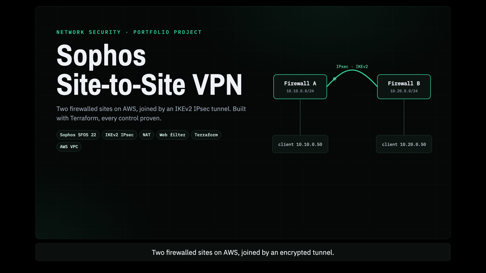
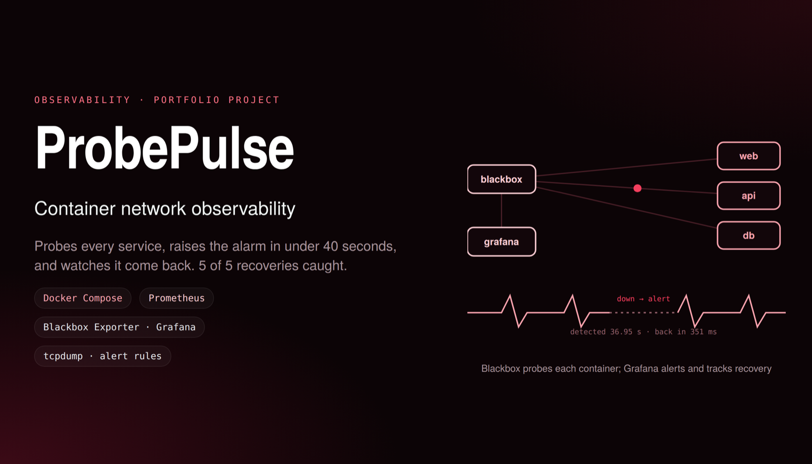
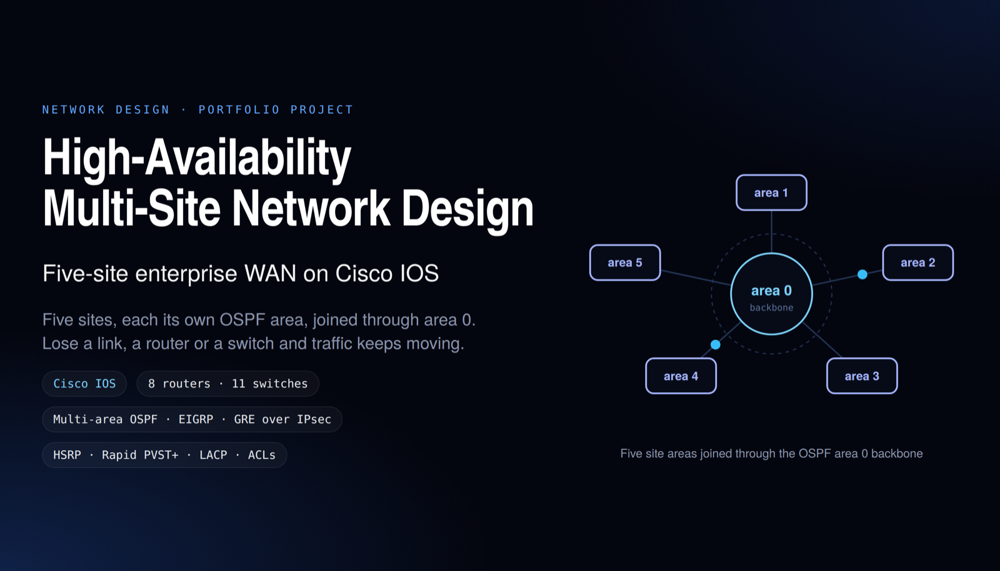
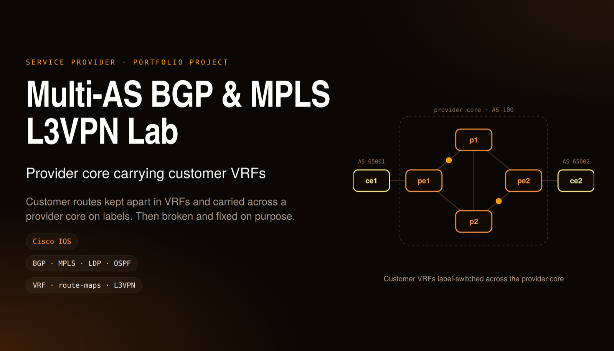
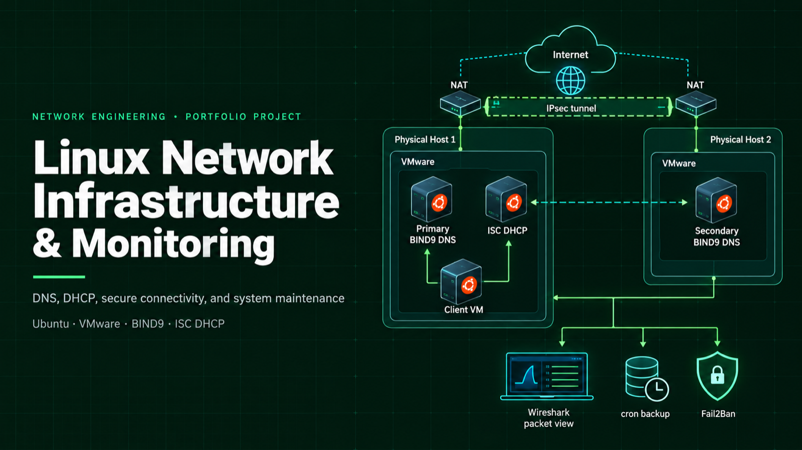
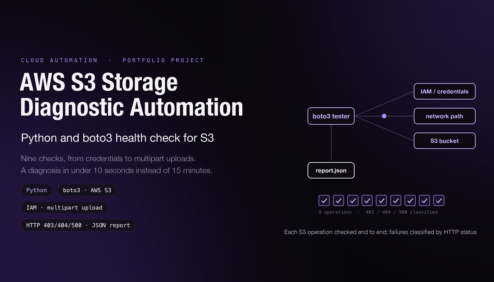

# 👋 Hi, I'm Jeevanandh Ravi

**Network Engineer · Network Automation · Cloud Networking · Cisco & Juniper**
MS in Telecommunication Networks, Northeastern University (Dec 2026) · JNCIA-Junos · Boston, MA (open to relocation)
🌐 **Portfolio:** [jeevanandh32.github.io](https://jeevanandh32.github.io)

I work on enterprise network troubleshooting and deployment. My lab projects explore validated configuration changes, staged rollouts, health checks, rollback, and cloud-network recovery under injected failures.

- 🛠️ Network Engineer co-op at **Global Partners**: resolved 300+ WAN, LAN, Wi-Fi and POS incidents across 890+ retail sites, with 88% resolved the same day
- 🎓 Graduate Teaching Assistant, **Linux for Network Engineers**, Northeastern University
- 🤖 Projects: multivendor EVPN-VXLAN automation with virtual Cisco NX-OS and Juniper Junos images, plus AWS–Azure networking in Terraform
- 🧠 AI-assisted engineering: I use coding agents to support design and debugging, then check changes with automated tests, virtual-switch lab output, and recorded benchmarks

## 🚀 Featured projects

### [FabricPilot: Multivendor EVPN-VXLAN Fabric Automation](https://github.com/Jeevanandh32/FabricPilot)

One source of truth (NetBox/YAML) drives Cisco NX-OS and Juniper Junos configs. Every change goes through a pipeline: **validate → render → plan → canary/batch rollout → health gate → verify → email report**.

- Canary-to-batch deployments with BGP/VXLAN health checks and automatic rollback (Junos `commit confirmed`, NX-OS checkpoints)
- Exercised on Nexus 9000v and vJunos-switch images in a containerlab fabric on Google Cloud; 54 local tests cover validation, rendering, rollout logic, and driver parsing
- Resolved documented Cisco/Juniper EVPN interoperability and CLI-handling issues; recorded cross-vendor Layer 2 and Layer 3 connectivity checks
- Ansible check mode reported no proposed changes on three Cisco switches; the README records matching configs after a NetBox inventory round trip
- [Validation scope](https://github.com/Jeevanandh32/FabricPilot#validation-scope): separate evidence for a six-device control-plane check, a 9/16 host ping matrix, and a later halted canary run
- `Python` `Jinja2` `Netmiko` `Ansible` `NetBox` `containerlab` `Google Cloud` `BGP EVPN` `VXLAN`

▶️ [Watch the 2-minute demo](https://github.com/Jeevanandh32/FabricPilot/blob/main/docs/fabricpilot-short.mp4)

### [CloudBridge: AWS–Azure Networking and Failover](https://github.com/Jeevanandh32/CloudBridge)

Terraform provisions AWS and Azure networks, EKS/AKS applications, two IPsec/IKEv2 tunnels with BGP, and Route 53 failover to a warm standby. Controlled failure tests are documented with [raw data and analysis](https://github.com/Jeevanandh32/CloudBridge/blob/main/docs/results.md).

- Measured 77–107 s client failover across three AWS application-loss tests and 68–78 s DNS failback after negative-cache tuning
- Observed a 0.8 s longest ping-reply gap, with nine unanswered probes, during one active-tunnel BGP failure test
- Measured path MTU and gateway MSS clamping; investigated route propagation, NACL return traffic, and load-balancer errors
- `Terraform` `AWS` `Azure` `EKS` `AKS` `IPsec/IKEv2` `BGP` `Route 53` `CloudWatch` `Azure Monitor`

### [Sophos Firewall Site-to-Site VPN Lab on AWS](https://github.com/Jeevanandh32/sophos-firewall-site-to-site-vpn-lab)

Two Sophos Firewalls (SFOS v22) in separate AWS VPCs, each protecting an Ubuntu host, built with Terraform and joined by an IKEv2 IPsec tunnel. Each layer was configured and checked in turn: **build → firewall rules → NAT → web filter → IPsec → tests → backup/restore**.

- IKEv2 IPsec through AWS 1:1 NAT: NAT-T on UDP 4500, Elastic IP identities, AES-256 with Curve25519
- Ordered deny/allow rules with logging, masquerade NAT and category web filtering; 14 of 14 validation tests passed from both sites, confirmed with tcpdump and the IPsec SA
- Found and fixed real issues on the live firewalls (IPsec blocked from the WAN zone, an API-created tunnel left inactive, backups needing a secure storage master key)
- Took an encrypted config backup, made a change, restored it, and confirmed the change was reverted after the reboot
- `Sophos Firewall` `IPsec/IKEv2` `NAT` `Web filtering` `Terraform` `CloudFormation` `AWS VPC/EC2` `tcpdump`

▶️ [Watch the 1-minute walkthrough](https://github.com/Jeevanandh32/sophos-firewall-site-to-site-vpn-lab/blob/main/docs/sophos-s2s-vpn-demo.mp4)

## 📂 More projects

### [ProbePulse: Container Network Observability & Recovery](https://github.com/Jeevanandh32/ProbePulse)

Docker Compose lab for HTTP, connection, and DNS diagnostics with tcpdump. Five local stopped-container tests recorded 36.95 s median Grafana alert detection and 351 ms median post-approval recovery to HTTP 200; all five recoveries succeeded. Detection excludes email-delivery time, and the recovery script handles a stopped target container.
`Docker Compose` `Prometheus` `Blackbox Exporter` `Grafana` `tcpdump` `Bash` `Python`

### [High-Availability Multi-Site Network Design](https://github.com/Jeevanandh32/Multi-Location-Network-Design-and-Implementation-using-Cisco-Packet-Tracer)

Five-site Cisco Packet Tracer lab with 8 routers and 11 switches. The project documents multi-area OSPF, EIGRP, GRE, VLAN segmentation, gateway redundancy, and connectivity checks. Redundancy configuration is separate from a measured failover-time or zero-loss guarantee.
`Cisco Packet Tracer` `Multi-area OSPF` `EIGRP` `GRE` `HSRP` `Rapid PVST+` `LACP` `ACLs`

### [Multi-AS BGP & MPLS L3VPN Lab](https://github.com/Jeevanandh32/Advanced-Network-Configuration-Troubleshooting)

A provider core (AS 100) carrying customer VRFs between customer sites in AS 65001 and AS 65002. Customer routes are kept apart in VRFs and label-switched across the core, then broken and fixed on purpose to practice troubleshooting.
`Cisco IOS` `BGP` `MPLS` `LDP` `OSPF` `VRF` `route-maps` `L3VPN`

### [Linux Network Infrastructure & Monitoring](https://github.com/Jeevanandh32/Adhoc-Network-Infrastructure-using-Linux)

Ubuntu lab examples for primary IPv4 BIND9 DNS zones, strongSwan IPsec/IKEv2, and archive/SCP backup automation. The repository includes configuration, diagnostic samples, and the limits of its current reproducibility.
`Ubuntu` `BIND9` `strongSwan` `IPsec/IKEv2` `Bash` `cron` `SCP`

### [AWS S3 Storage Diagnostic Automation](https://github.com/Jeevanandh32/AWS-S3-Connectivity-Tester)

Python/boto3 tool for credential validation and S3 bucket, object, multipart-upload, and versioning checks, with JSON reporting and separate SDK error-handling examples. Cleanup failures are reported; no measured diagnostic-time improvement is claimed.
`Python` `boto3` `AWS S3` `IAM` `JSON`

Earlier projects

- [Secure Communication Using RSA Encryption](https://github.com/Jeevanandh32/Secure-Communication-Using-RSA-Encryption): Python RSA key exchange and encrypted client-server chat
- [Socket Programming in Python](https://github.com/Jeevanandh32/SOCKET-PROGRAMMING-IN-PYTHON)

## 🧠 AI skills (used in my projects)

| Skill | Where I used it |
|---|---|
| **Building with AI coding agents** | Built FabricPilot (Python, Jinja2, Ansible, 54 tests) and ProbePulse by directing an AI agent through design, code, tests and docs |
| **Verifying AI output** | Checked generated configuration and code against virtual Cisco/Juniper lab output, automated tests, and recorded measurements |
| **AI-assisted troubleshooting** | Used AI to analyze device output and logs while investigating documented CLI and Cisco/Juniper EVPN interoperability issues |
| **Human-in-the-loop automation** | Kept people in control: operator-approved remediation in ProbePulse; changes, commits and deployments approved by me first |

## 🛠️ Skills

| Area | Tools and technologies |
|---|---|
| **Networking** | TCP/IP, IPv4/IPv6 subnetting, VLANs, 802.1Q, STP/RSTP, OSPF, BGP, DHCP, DNS, NAT/PAT, MPLS, EVPN-VXLAN, IPsec/IKEv2 site-to-site VPN |
| **Network platforms** | Cisco IOS/IOS XE, Cisco NX-OS, Cisco Meraki Dashboard, Junos OS, Sophos Firewall (SFOS) |
| **Automation** | Python, Bash, Ansible, Terraform, Netmiko, NetBox, Jinja2, YAML, REST APIs, JSON, Git, Bitbucket |
| **Systems** | Ubuntu Linux, VMware, Docker, Docker Compose, containerlab |
| **Monitoring & troubleshooting** | SolarWinds Orion, SNMP, Prometheus, Grafana, ServiceNow, Wireshark, tcpdump |
| **AI-assisted engineering** | AI coding agents, AI-assisted debugging and testing, human-in-the-loop automation |
| **Cloud** | AWS (VPC, EKS, Route 53, S3, IAM, EC2, CloudFormation, boto3), Azure (VNet, AKS, VPN Gateway, Monitor), Google Cloud (Compute Engine, Cloud Storage) |

## 💼 Experience

**Graduate Teaching Assistant, Linux for Network Engineers**, Northeastern University · *Sep 2026 – Present*
Co-run hands-on Linux labs for 20+ graduate students (Ubuntu, Bash scripting); write lab guides and troubleshoot student VM setups.

**Network Engineer (Co-op)**, Global Partners, Waltham, MA · *Jan 2026 – Jun 2026*
- Tier 1/2 investigations: 300+ WAN, LAN, Wi-Fi and POS incidents across 890+ retail sites, 88% resolved the same day
- Configured Cisco routers and switches and provisioned Meraki APs and cellular gateways (VLANs, access/trunk ports, IP addressing, DHCP)
- Isolated VLAN mismatches, port-security violations, DHCP errors and DMVPN faults; upgraded Cisco IOS/IOS XE
- Coordinated 60+ carrier escalations; configured RPDU/UPS remote management and fusion-spliced fiber in a company-owned data center

**R&D Intern**, boAt (Imagine Marketing), Bangalore, India · *Jan 2024 – May 2024*
Prototyped C firmware for a TWS charging case (TI MSPM0L1306 MCU, SSD1306 OLED over I2C), managed in Git.

## 📜 Certifications

  
  &nbsp;&nbsp;
  

- **Juniper Networks Certified Associate, Junos (JNCIA-Junos)**, Oct 2026
- **AMD ROCm Certified Associate**, Oct 2026 – Oct 2028
- Master Network Automation with Python for Network Engineers (Udemy)

## 📫 Contact

- **Portfolio:** [jeevanandh32.github.io](https://jeevanandh32.github.io)
- **Email:** jeevanandhravi@gmail.com
- **LinkedIn:** [linkedin.com/in/jeevanandhravi](https://www.linkedin.com/in/jeevanandhravi/)
